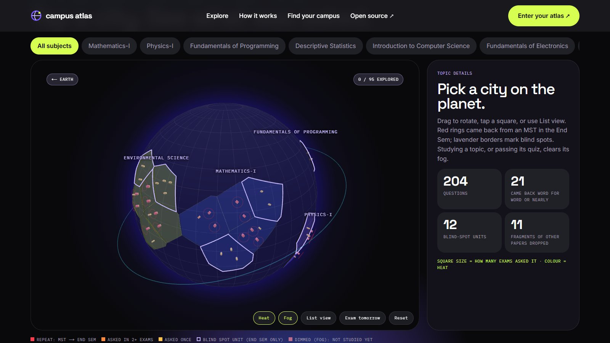
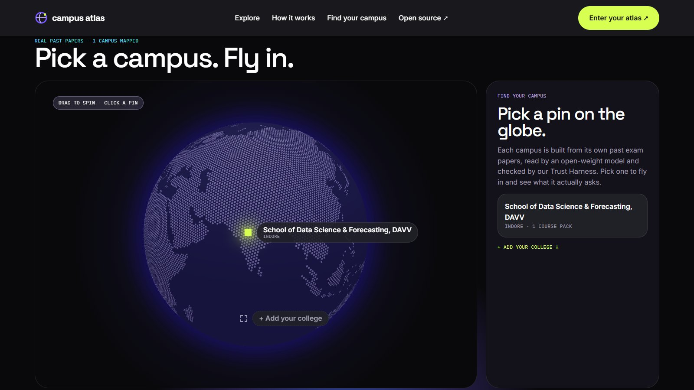
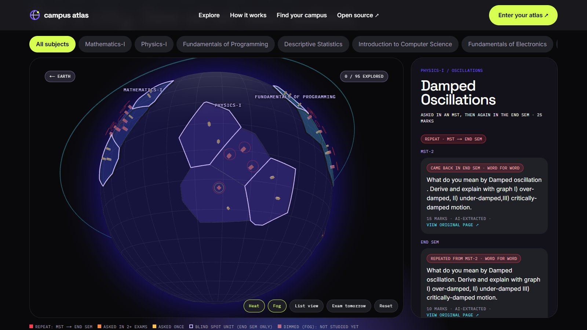

# Campus Atlas

**See what your university actually asks.**

Every university teaches the same subjects, but each one asks different exam questions. Campus Atlas
turns a college's past exam papers into an interactive 3D planet: subjects are continents, units are
countries, topics are glowing cities. Red rings mark topics that came back from a mid-sem test in the End
Sem. Lavender borders are blind spots: units the mid-sems never tested that still filled the End Sem.

It is powered by an open-weight model (Gemma 4), wrapped in our own **PYQ Trust Harness**, packaged as
an open-standard **Agent Skill**, and released under Apache-2.0.

> Live site: **https://campus-atlas.vercel.app**



| Earth view | Topic panel |
|---|---|
|  |  |

## What it found (DAVV, M.Tech AI&DS, Semester 1)

From 21 papers (3 exams x 7 subjects, 22 phone photos), the pipeline found, without any of this being
hard-coded:

- **21 questions that came back** from MST-1/MST-2 in the End Sem (9 word for word, 12 nearly so),
  plus 31 End Sem questions on the same specific topic as an MST question.
- **Blind spots:** units with no MST question but real End Sem marks, e.g. Physics *Optics* and
  *Lasers*, Statistics *Correlation and Regression* and *Index Numbers*, Programming
  *Object-Oriented Programming*, Electronics *Operational Amplifiers*.
- 204 questions kept, 11 fragments of other papers dropped, 0 left unsure.
  Full run report: [runs/sample/report.md](runs/sample/report.md).

## Open-source AI inside

- **Gemma 4** (open weights, Apache-2.0) does all the reading and judging: page orientation, header
  reading, question extraction (LaTeX for maths, markdown for tables), the bleed-through check,
  grouping questions into units and topics, judging borderline repeats, and writing quizzes.
  We use `gemma-4-31b-it`, falling back to `gemma-4-26b-a4b-it` when the API is overloaded.
- **An open embedding model** (`all-MiniLM-L6-v2`, runs locally) finds repeated questions.
- **No proprietary API needed:** set `MODEL_PROVIDER=openai_compatible` and the same pipeline runs on
  Ollama on your laptop, or on a DigitalOcean GPU Droplet.
- The website never calls a model: it reads one JSON file per college.

## The PYQ Trust Harness

AI reading messy phone photos is unreliable, so every step is checked before anything reaches the map.
Nothing is silently dropped: anything the harness cannot verify goes to an "unsure" list.

```mermaid
flowchart LR
  A[1 render<br/>PDF to PNG] --> B[2 orient<br/>model + Pillow]
  B --> C[3 header<br/>manifest overrides,<br/>disagreements logged]
  C --> D[4 extract<br/>strict JSON, LaTeX, tables]
  D --> E[5 validate<br/>pydantic, retry once,<br/>else unsure]
  E --> F[6 contamination<br/>is it on this sheet?<br/>drop bleed-through]
  F --> G[7-8 units + topics<br/>every question placed once]
  G --> H[9 repeats<br/>embeddings + model judge]
  H --> I[10 scoring<br/>repeats, blind spots, marks]
  I --> J[11 quizzes<br/>3 validated MCQs per topic]
  J --> K[12 pack JSON<br/>+ run report]
```



Things the harness had to handle in the real papers:

- an upside-down photo (the model spotted it and Pillow turned it), and pages photographed landscape;
- **bleed-through**: fragments of other papers under the photo, e.g. an Environmental Science question
  at the bottom of a Physics page, and faint text of the Programming paper showing *through* the Intro to
  CS page. The harness dropped 11 such fragments, each logged with the visual reason;
- unreliable course codes (`DS6A-101` is printed on both Maths and Programming), so subjects are matched
  by name and an alias table, never by code;
- a header that says "test 2" on an MST-1 paper (the human manifest wins and the disagreement is
  logged), and a Semester 1 paper headed "Semester-III".

Every model answer is cached on disk, so a re-run is repeatable and needs no live calls for anything
already answered.

### Eval: did it find the repeats a human found?

[pipeline/eval/expected_repeats.json](pipeline/eval/expected_repeats.json) holds 19 MST to End Sem
repeats from a manual check of the papers. A hit needs a repeat link whose **both** questions match
the topic, by text, never by question number. `python -m pipeline.eval` prints every matched pair so
a person can check it.

**Repeat detection: found 18 of 19 expected.**

The miss (#9) is the same curve, y²(2a−x) = x³, asked as "find the area" in MST-2 and "trace it" in the
End Sem. The two questions are too different for the embedding model and landed in different topics.

How we got there, honestly:

- The first full run caught a harness bug: a text-only bleed-through check dropped 6 real questions
  (including the OOP section) because their topic "looked too advanced". The check now looks at the photo
  and asks whether the text is on the main sheet.
- With the spec thresholds alone (cosine ≥ 0.85 is a repeat, 0.70-0.85 is judged by the model), it found
  16 of 19. Using the topic grouping as a second signal (same-topic pairs are judged from 0.55) found 18.
  The eval set guided that change, so treat the number as optimistic for other colleges.
- The eval itself was tightened after we checked its matches by eye: one "hit" linked two different curves.

## Agent Skill: `pyq-atlas`

[skills/pyq-atlas/](skills/pyq-atlas/SKILL.md) follows the [Agent Skills](https://agentskills.io/specification)
open standard and passes the official checker:

```bash
skills-ref validate ./skills/pyq-atlas    # Valid skill
```

Any skills-compatible agent can add a new college by running this skill: it explains the inputs
(papers + `manifest.yaml`), runs the pipeline through `scripts/run_pipeline.py`, and documents the pack
schema and common problems (rotated pages, bleed-through, old syllabus, API errors).

## Why open matters here

- **Free for every student.** No subscription between a student and their own university's papers.
- **Colleges can run it on their own servers**, on open weights, with nothing leaving campus.
- **Student papers never need to go to a closed AI company.**
- **Anyone can add their college** by pull request, and every number on the map can be traced back to a
  photo of the original page.

## Add your college

See [CONTRIBUTING.md](CONTRIBUTING.md): drop the PDFs, write a short manifest, run the skill, open a PR
with the pack.

## Honest limits

- **One year of papers** (2025-26, three exams). A topic asked once may still be important.
- **No syllabus was used** for this pack: units and topics are grouped from the questions themselves.
  When a syllabus is used it is the 2024-29 batch's, which may be outdated, and the site labels it as old.
- **AI extraction can be wrong.** Every question on the site links to a photo of its original page.
- Repeat detection was measured on one college's papers (18 of 19); expect less elsewhere.

## Run it yourself

```bash
# pipeline (Python 3.11+)
python -m venv .venv
.venv/Scripts/python -m pip install -r pipeline/requirements.txt   # macOS/Linux: .venv/bin/python
cp .env.example .env                                                # choose a provider, add a key
.venv/Scripts/python -m pipeline.build_pack --all                  # steps 1-10 and 12
.venv/Scripts/python -m pipeline.build_pack --stage quiz           # step 11
.venv/Scripts/python -m pipeline.eval --write                  # stores the result in the pack for the site

# website (Node 20+)
cd web
npm install
npm run dev        # http://localhost:3000
npm run build      # static site in web/out
```

## Deploy (Vercel)

The site is a static export (no server, no AI calls), so Vercel only serves files. Import this
repo at vercel.com/new and choose **Import single project** next to `web` (Next.js): Root
Directory `web`, default build settings, no environment variables. The build reads `packs/` from
the repo root, which Vercel includes by default ("Include files outside the root directory").
Every push to `main` redeploys.

## Repo layout

```
data/raw/      page manifest (human ground truth); the scanned PDFs stay local, every page is in packs/<college>/pages/
pipeline/      PYQ Trust Harness (Python)
packs/         college packs (JSON) + page photos; the only thing the website reads
runs/sample/   run report of the full pipeline run
skills/        pyq-atlas Agent Skill
web/           Next.js website (static export)
```

## License

Apache-2.0. See [LICENSE](LICENSE).
